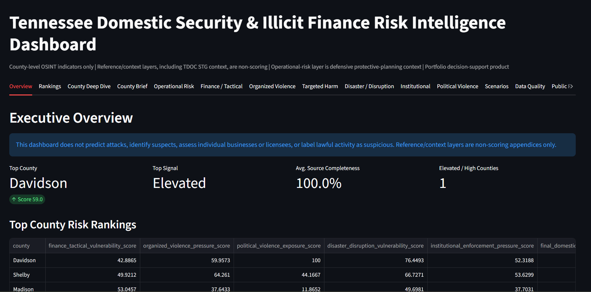
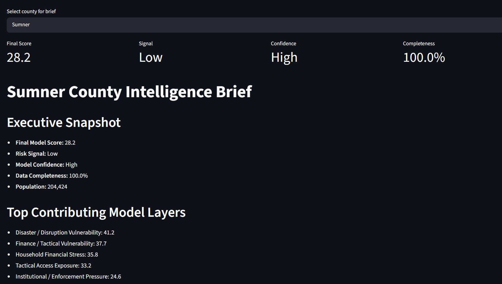
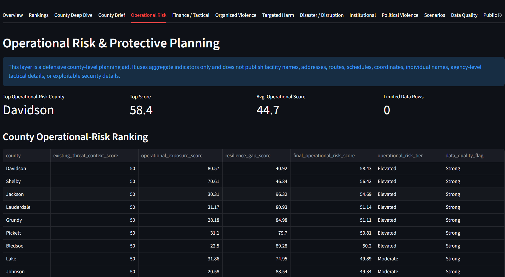
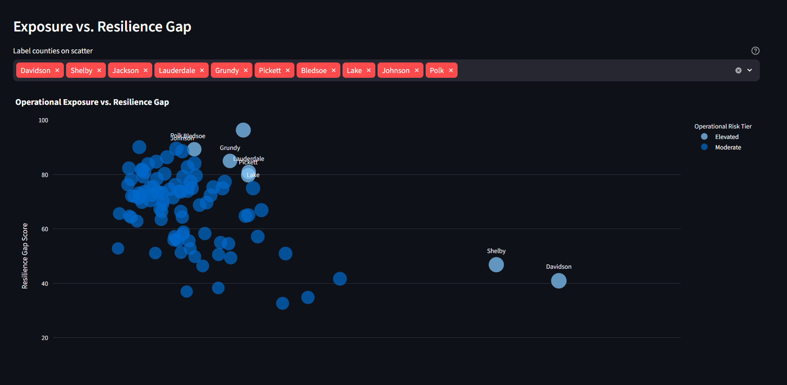
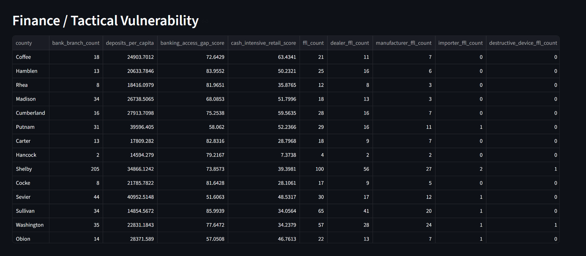
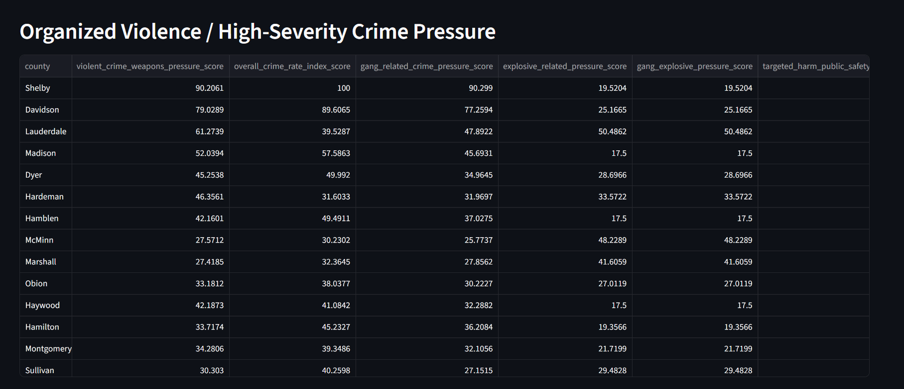
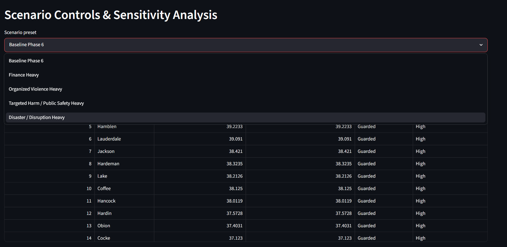
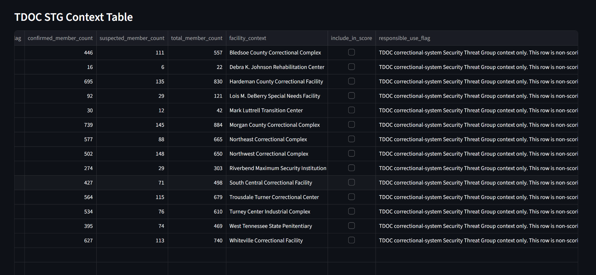

# Tennessee Domestic Security & Illicit Finance Risk Intelligence Model

**County-level OSINT model for illicit-finance vulnerability, cash-economy exposure, tactical-access indicators, organized/group criminal activity indicators, explosive-use indicators, targeted-harm indicators, public-safety personnel pressure, disaster/disruption vulnerability, institutional/enforcement pressure, operational-risk / protective-planning context, public group / network reference context, TDOC correctional-system STG context, statewide hate-crime context, political violence / civil unrest exposure, and domestic security risk in Tennessee.**

Prepared by **Jason Keen**  
Contact: **keenjasonr@gmail.com**

---

## Project Overview

This project builds a county-level open-source intelligence model for Tennessee that combines public socioeconomic, financial, business, tactical-access, disaster/disruption, crime/weapons, organized-crime, explosive-use, targeted-harm, public-safety personnel, political violence / civil unrest, operational-risk, sensitivity-analysis, trend-analysis, source-reference, and report-context indicators into a structured domestic security risk intelligence framework.

The model is designed to support analytical thinking around:

- Illicit-finance vulnerability
- Cash-economy exposure
- Formal banking access gaps
- Tactical-access and equipment-access indicators
- ATF FFL aggregate exposure
- TBI CrimeInsight crime/weapons pressure
- TBI overall crime-rate pressure
- TBI gang-related criminal activity pressure
- TBI explosive-use criminal activity pressure
- TBI gang + explosive-use intersection pressure
- TBI hate-crime / targeted-harm pressure
- TBI law-enforcement ambush pressure
- Law-enforcement assault pressure
- Targeted harm / public-safety pressure
- Institutional / enforcement pressure
- ACLED political violence / civil unrest exposure
- Socioeconomic stress
- FEMA disaster exposure
- Phase 6 disaster/disruption vulnerability
- Operational Risk & Protective Planning context
- TDOT transportation pressure
- Sycamore healthcare capacity context
- TACIR infrastructure needs context
- CSLLEA law-enforcement response-capacity baseline
- Public group / network reference context
- TDOC correctional-system STG context
- TBI 2024 statewide hate-crime context
- CrimeInsight trend analysis
- Model-weight sensitivity and rank stability
- County-level data quality and model confidence

The model **does not predict attacks**, identify suspects, assess individual businesses, assess individual licensees, identify threat actors, infer motive or ideology, or label lawful activity as suspicious. It uses aggregate county-level indicators only.

---

## Dashboard Preview

The Streamlit dashboard presents the model outputs through county rankings, county intelligence briefs, operational-risk views, component tables, scenario controls, data-quality checks, and non-scoring reference/context tabs.

### Executive Overview



### County Intelligence Brief



### Operational Risk & Protective Planning



### Operational Exposure vs. Resilience Gap



### Finance / Tactical Vulnerability



### Organized Violence / High-Severity Crime Pressure



### Scenario Controls & Sensitivity Analysis



### TDOC STG Correctional-System Context



---

## Responsible Use Statement

This project is intended for portfolio, research, and analytical demonstration purposes.

The model should not be used to:

- Identify individuals
- Profile businesses or licensees
- Target lawful commercial activity
- Infer criminal conduct from county-level indicators
- Label gang-related crime as terrorism
- Label explosive-use crime as terrorism
- Label hate-crime offense counts as terrorism
- Label law-enforcement ambush counts as terrorism
- Infer motive, ideology, or actor identity
- Predict specific acts of violence
- Produce site-level tactical maps
- Produce operational targeting outputs
- Publish facility-level infrastructure vulnerability details
- Make enforcement, investigative, legal, employment, financial, or operational decisions

Business categories such as tobacco/vape retail, firearm-related retail, FFL aggregates, pawn/used merchandise, tactical training, gun ranges, military-surplus proxies, and similar lawful categories are treated only as **aggregate exposure indicators**. Their inclusion does not imply misconduct by any business, owner, employee, customer, licensee, county, or agency.

Gang-related crime, explosive-use crime, gang-related explosive-use crime, hate-crime offense counts, and law-enforcement ambush counts are treated as **aggregate public-safety / high-severity pressure indicators**, not terrorism indicators.

The public group / network reference register, TDOC correctional-system STG context, and TBI statewide hate-crime context tables are **reference-only / context-only appendices**. They are not included in risk scoring and should not be interpreted as county-risk, terrorism, criminality, operational-presence, or threat-actor labels.

The Operational Risk & Protective Planning layer is defensive and county-level only. It does not identify targets, facilities, addresses, routes, schedules, individual agencies, individuals, or exploitable vulnerabilities.

---

## Current Model Phase

This repository currently reflects a **Phase 6 dashboard, operational-risk, and reference/context build**.

### Active Layers

| Layer | Status | Description |
|---|---:|---|
| ACS Socioeconomic Stress | Active | Poverty, unemployment, income stress, rent burden |
| Census CBP Business Exposure | Active | County establishment counts for selected NAICS categories |
| FDIC Banking Access | Active | Branch counts and deposit-depth indicators |
| ATF FFL Aggregate Inputs | Active | County-level FFL counts and subtype counts, including importer and destructive-device-related fields |
| FEMA Disaster Exposure | Active | Disaster declaration count, recent declaration exposure, disaster-type diversity |
| Phase 6 Disaster / Disruption Vulnerability | Active | Severe weather, power disruption, access stress, communications disruption, social vulnerability, recovery strain, repeat disruption |
| TBI CrimeInsight Crime/Weapons | Active | Homicide, kidnapping/abduction, weapon law violations, aggravated assault, arson, sex offenses, hate crime, law-enforcement assault |
| TBI Overall Crime Rate | Active | Overall crime rate, total crime count, and crime population |
| TBI Gang-Related Activity | Active | County-level gang-related criminal activity aggregate indicators |
| TBI Explosive-Use Activity | Active | County-level explosive-use criminal activity aggregate indicators |
| TBI Gang + Explosive Intersection | Active | County-level gang-related explosive-use aggregate indicators |
| TBI Hate-Crime / Targeted-Harm Activity | Active | County-level hate-crime offense aggregates |
| TBI Law-Enforcement Ambush Activity | Active | County-level law-enforcement ambush offense aggregates |
| Targeted Harm / Public-Safety Pressure | Active | Hate-crime / targeted-harm and law-enforcement ambush composite |
| Institutional / Enforcement Pressure | Active | Derived public-safety and response-pressure score |
| ACLED Political Violence / Civil Unrest | Active | County-level protest, public disorder, political violence, strategic development, and fatality aggregates |
| Operational Risk & Protective Planning | Active, Separate Layer | County-level exposure, resilience gap, infrastructure pressure, healthcare capacity, transportation pressure, and law-enforcement response-capacity context |
| Public Group / Network Reference Register | Active, Non-Scoring | SPLC-derived and manually reviewed public-source reference register |
| TDOC STG Correctional-System Context | Active, Non-Scoring | Sanitized TDOC correctional-system STG historical and FY2025 facility aggregate context |
| TBI 2024 Hate Crime Report Context | Active, Non-Scoring | Statewide hate-crime context tables used in report appendix |
| Crime Trend Analysis | Active | 2023–2024 selected CrimeInsight crime/weapons trend analysis |
| Sensitivity Analysis | Active | Alternative weighting scenarios and rank-stability testing |
| Data Quality / Model Confidence | Active | Source availability and completeness scoring |
| Streamlit Dashboard | Active | Interactive display layer with county briefs, charts, scenario controls, reference tabs, and PDF download |

---

## Data Sources

The model uses public-source APIs and locally processed aggregate data.

### Automated / API Sources

| Source | Use |
|---|---|
| U.S. Census Bureau ACS 5-Year API | Population, poverty, unemployment, income, rent burden |
| U.S. Census Bureau County Business Patterns API | County business establishment counts by selected NAICS codes |
| FEMA OpenFEMA Disaster Declarations Summaries | County disaster declaration exposure |
| ACLED API | Tennessee political violence / civil unrest events aggregated to county level |

### Local Aggregate Inputs

| File | Purpose |
|---|---|
| `data/raw/tn_fdic_banking_inputs.csv` | County-level FDIC branch and deposit inputs |
| `data/raw/tn_ffl_county_inputs.csv` | County-level ATF FFL aggregate inputs |
| `data/raw/tn_crime_weapons_inputs.csv` | County-level TBI CrimeInsight crime/weapons inputs |
| `data/raw/tn_crime_rate_inputs.csv` | County-level TBI overall crime-rate inputs |
| `data/raw/tn_political_violence_inputs.csv` | County-level ACLED political violence / civil unrest inputs |
| `data/raw/tn_gang_activity_inputs.csv` | County-level TBI gang-related activity inputs |
| `data/raw/tn_explosives_activity_inputs.csv` | County-level TBI explosive-use activity inputs |
| `data/raw/tn_gang_explosives_activity_inputs.csv` | County-level TBI gang + explosive-use inputs |
| `data/raw/tn_hate_crime_offense_inputs.csv` | County-level TBI hate-crime offense inputs |
| `data/raw/tn_law_enforcement_ambush_inputs.csv` | County-level TBI law-enforcement ambush inputs |
| `data/raw/tn_disaster_disruption_inputs.csv` | County-level disaster/disruption vulnerability inputs |
| `data/raw/tn_tactical_access_inputs.csv` | Optional county-level tactical training, surplus/tactical retail, and gun range inputs |
| `data/raw/tn_public_group_reference_inputs.csv` | Reviewed public group / network reference input; reference-only and non-scoring |
| `data/raw/splc_hate_data_2024.csv` | SPLC Tennessee 2024 Hate Map CSV input used to create candidate public-reference rows |
| `data/raw/2025 Statistical Abstract.pdf` | TDOC FY2025 Statistical Abstract used for sanitized facility-level STG aggregate context |
| `data/raw/stg_threat_assessment__tn_major_groups__apr_2010__les_.pdf` | Historical TDOC correctional-system STG context; broad historical names only, no operational details retained |

### Operational-Risk Source Inputs

| File | Purpose |
|---|---|
| `data/raw/tn_county_profile_data.csv` | County profile fields for the operational-risk layer |
| `data/raw/tn_county_transport_context.csv` | TDOT-derived county-level transportation context |
| `data/raw/tn_county_healthcare_capacity.csv` | Sycamore-derived county-level healthcare capacity context |
| `data/raw/tn_county_infrastructure_needs.csv` | TACIR-derived county-level infrastructure-needs context |
| `data/raw/tn_county_law_enforcement_capacity.csv` | CSLLEA-derived county-level law-enforcement response-capacity baseline |

### Processor Inputs

| File | Processor |
|---|---|
| `data/raw/fdic_summary_of_deposits.csv` | `python -m src.fdic_processor` |
| `data/raw/atf_ffl_listing.csv` | `python -m src.ffl_processor` |
| `data/raw/crimes_clearances_by_offense_type_2024.csv` | `python -m src.crime_offense_processor` |
| `data/raw/crime_rates_by_jurisdiction_2024.csv` | `python -m src.crime_rate_processor` |
| `data/raw/tn_gang_activity_raw_2024.csv` | `python -m src.gang_activity_processor` |
| `data/raw/tn_explosives_activity_raw_2024.csv` | `python -m src.explosives_processor` |
| `data/raw/tn_gang_explosives_activity_raw_2024.csv` | `python -m src.gang_explosives_processor` |
| `data/raw/tn_hate_crime_offense_raw_2024.csv` | `python -m src.hate_crime_processor` |
| `data/raw/tn_law_enforcement_ambush_raw_2024.csv` | `python -m src.law_enforcement_ambush_processor` |
| `data/raw/splc_hate_data_2024.csv` | `python -m src.splc_group_reference_processor` |
| `data/raw/tn_public_group_reference_inputs.csv` | `python -m src.public_group_reference` |
| TBI 2024 Hate Crime Report values | `python -m src.tbi_hate_crime_report_context` |
| TDOC 2010 / FY2025 PDFs | `python -m src.tdoc_stg_reference_processor` |
| `.env` ACLED credentials | `python -m src.acled_processor` |
| `data/raw/tn_crime_weapons_inputs_2023.csv` and `data/raw/tn_crime_weapons_inputs_2024.csv` | `python -m src.crime_trend_analysis` |

---

## Environment Variables

Create a `.env` file in the project root.

```text
CENSUS_API_KEY=PASTE_YOUR_CENSUS_KEY_HERE

ACLED_USERNAME=your_acled_username_or_email
ACLED_PASSWORD=your_acled_password
ACLED_START_DATE=2023-01-01
ACLED_END_DATE=2024-12-31
ACLED_SAVE_FULL_RAW=false
```

Do not hard-code API credentials in Python files.

---

## Model Architecture

The final score is a weighted index composed of active Phase 6 components.

### Finance / Tactical Vulnerability Score

| Subcomponent | Weight |
|---|---:|
| Household Financial Stress | 24% |
| Banking Access Gap | 16% |
| Cash-Intensive Retail Exposure | 20% |
| Tobacco / Vape Exposure | 12% |
| Tactical Access Exposure | 20% |
| Disaster / Disruption Exposure | 8% |

### Crime / Weapons Pressure Score

| Subcomponent | Weight |
|---|---:|
| Weapon Law Violation Pressure | 30% |
| Violent Crime Pressure | 20% |
| Aggravated Assault Pressure | 15% |
| Homicide Pressure | 15% |
| Kidnapping / Abduction Pressure | 10% |
| Arson Pressure | 5% |
| Sex Offense Pressure | 3% |
| Hate Crime Pressure | 1% |
| Law-Enforcement Assault Pressure | 1% |

### Organized Violence / High-Severity Crime Pressure Score

| Subcomponent | Weight |
|---|---:|
| TBI Crime / Weapons Pressure | 30% |
| Overall Crime Rate Index | 15% |
| Gang-Related Criminal Activity Pressure | 18% |
| Explosive-Use Criminal Activity Pressure | 13% |
| Gang + Explosive Intersection Pressure | 13% |
| Targeted Harm / Public-Safety Pressure | 11% |

### Targeted Harm / Public-Safety Pressure Score

| Subcomponent | Weight |
|---|---:|
| Hate-Crime / Targeted-Harm Pressure | 55% |
| Law-Enforcement Ambush Pressure | 45% |

### Political Violence / Civil Unrest Exposure Score

| Subcomponent | Weight |
|---|---:|
| Protest Event Pressure | 20% |
| Public Disorder Event Pressure | 20% |
| Total ACLED Event Pressure | 20% |
| Violent Unrest Event Pressure | 15% |
| Political Violence Event Pressure | 15% |
| Strategic Development Pressure | 5% |
| ACLED Fatality Pressure | 5% |

### Disaster / Disruption Vulnerability Score

This score combines FEMA historical disaster exposure with optional Phase 6 county-level disruption fields.

| Subcomponent | Description |
|---|---|
| FEMA disruption exposure | Disaster declarations, recent declarations, disaster-type diversity |
| Severe weather exposure | Severe storm, flood, tornado, winter weather, wildfire, drought |
| Power disruption exposure | Power outage count and average outage duration |
| Access stress | Hospital, airport, road, and communications stress |
| Recovery strain | Social vulnerability, recovery strain, repeat disruption exposure |

### Institutional / Enforcement Pressure Score

| Subcomponent | Weight |
|---|---:|
| Law-Enforcement Ambush Pressure | 25% |
| Law-Enforcement Assault Pressure | 20% |
| Crime / Weapons Pressure | 20% |
| Overall Crime Rate Index | 15% |
| Targeted Harm / Public-Safety Pressure | 10% |
| Disaster / Disruption Vulnerability | 10% |

### Final Domestic Security Risk Score

| Component | Weight |
|---|---:|
| Finance & Tactical Vulnerability | 30% |
| Organized Violence / High-Severity Crime Pressure | 20% |
| Political Violence / Civil Unrest Exposure | 15% |
| Household Financial Stress | 15% |
| Disaster / Disruption Vulnerability | 10% |
| Tactical Access Exposure | 5% |
| Institutional / Enforcement Pressure | 5% |

### Operational Risk & Protective Planning Score

The operational-risk score is maintained outside the final domestic-security risk score. It combines:

| Component | Treatment |
|---|---|
| Existing Threat Context | Uses existing county-level model context as one input |
| Operational Exposure | Population, density, socioeconomic pressure, transportation pressure, infrastructure pressure, and public-safety context |
| Resilience Gap | Healthcare capacity gap, FEMA vulnerability/resilience gap, and law-enforcement capacity gap |
| Final Operational Risk | Separate defensive planning score with Low, Moderate, Elevated, or High tier labels |

### Non-Scoring Reference / Context Layers

| Layer | Use |
|---|---|
| Public Group / Network Reference Register | PDF appendix, dashboard reference tab, and analyst-reference table only |
| SPLC Public Group Reference Candidates | Source-assisted candidate table used before public-reference validation |
| TDOC STG Correctional-System Context | Sanitized correctional-system context appendix only; not county scoring |
| TBI 2024 Hate Crime Report Context | Statewide hate-crime context appendix only |

These layers are not included in any score, rank, risk signal, sensitivity scenario, or county ranking.

---

## Key Outputs

After running the pipeline, outputs are saved under `outputs/`.

### Tables

| Output | Description |
|---|---|
| `outputs/tables/tn_county_master_dataset.csv` | Merged county-level dataset before scoring |
| `outputs/tables/tn_county_domestic_security_scores.csv` | Full scored county-level dataset |
| `outputs/tables/tn_county_component_scores.csv` | Summary score components |
| `outputs/tables/tn_county_finance_tactical_scores.csv` | Finance, banking, retail, tactical, and disruption indicators |
| `outputs/tables/tn_county_crime_weapons_scores.csv` | Crime/weapons indicators, rates, organized violence fields, and scores |
| `outputs/tables/tn_county_organized_violence_scores.csv` | Gang, explosives, gang + explosives, targeted harm, overall crime, and organized violence pressure fields |
| `outputs/tables/tn_county_targeted_harm_public_safety_scores.csv` | Hate-crime, law-enforcement ambush, and targeted harm / public-safety fields |
| `outputs/tables/tn_county_disaster_disruption_scores.csv` | FEMA, disaster/disruption, access stress, recovery strain, and disruption vulnerability fields |
| `outputs/tables/tn_county_institutional_enforcement_scores.csv` | Law-enforcement assault, ambush, crime pressure, targeted harm, disruption, and institutional/enforcement pressure fields |
| `outputs/tables/tn_county_political_violence_scores.csv` | ACLED political violence / civil unrest counts, rates, and scores |
| `outputs/tables/tn_county_data_quality_flags.csv` | Data availability and model-confidence flags |
| `data/processed/tn_operational_risk_features.csv` | Operational Risk & Protective Planning feature layer |
| `outputs/tables/model_weight_sensitivity_results.csv` | Scenario-level sensitivity scores and ranks |
| `outputs/tables/top_county_rank_stability.csv` | County rank-stability summary across sensitivity scenarios |
| `outputs/tables/scenario_top_county_leaders.csv` | Top counties under each sensitivity scenario |
| `outputs/tables/tn_crime_weapons_trend_analysis.csv` | 2023–2024 selected CrimeInsight crime/weapons trend analysis |
| `outputs/tables/tn_gang_activity_summary.csv` | County-level gang-related activity summary |
| `outputs/tables/tn_explosives_activity_summary.csv` | County-level explosive-use activity summary |
| `outputs/tables/tn_gang_explosives_activity_summary.csv` | County-level gang + explosive-use intersection summary |
| `outputs/tables/tn_hate_crime_offense_summary.csv` | County-level hate-crime offense summary |
| `outputs/tables/tn_law_enforcement_ambush_summary.csv` | County-level law-enforcement ambush summary |
| `outputs/tables/tn_splc_public_group_reference_candidates_2024.csv` | SPLC-derived candidate public group / network reference rows; non-scoring |
| `outputs/tables/tn_public_group_activity_reference.csv` | Validated public group / network reference register; non-scoring |
| `outputs/tables/tn_public_group_reference_validation.csv` | Validation table for public group / network reference input |
| `outputs/tables/tn_tdoc_stg_reference_context.csv` | Sanitized TDOC correctional-system STG context table; non-scoring |
| `outputs/tables/tn_tdoc_stg_reference_validation.csv` | TDOC STG context validation summary |
| `outputs/tables/tn_2024_hate_crime_bias_context.csv` | TBI 2024 statewide hate-crime bias context; non-scoring |
| `outputs/tables/tn_2024_hate_crime_offense_context.csv` | TBI 2024 statewide hate-crime offense context; non-scoring |
| `outputs/tables/tn_2024_hate_crime_clearance_context.csv` | TBI 2024 statewide hate-crime clearance context; non-scoring |
| `outputs/tables/tn_2024_hate_crime_location_context.csv` | TBI 2024 statewide hate-crime location context; non-scoring |
| `outputs/tables/tn_2024_hate_crime_report_context_summary.csv` | TBI 2024 statewide hate-crime summary context; non-scoring |
| `outputs/tables/source_register.csv` | Source register used in the PDF report |

### Charts

Charts are saved in:

```text
outputs/charts/
```

Current charts include final risk rankings, finance/tactical vulnerability, organized violence / high-severity crime pressure, institutional/enforcement pressure, disaster/disruption vulnerability, targeted harm, law-enforcement ambush pressure, ACLED exposure, gang/explosive layers, tactical access, banking access gap, operational-risk rankings, operational exposure, resilience gap, infrastructure pressure, healthcare capacity gap, law-enforcement capacity gap, operational scatterplots, sensitivity rank stability, and CrimeInsight trend charts.

Zero-only and no-variation charts are skipped to avoid displaying non-informative flat rankings.

### Report

The final PDF is saved as:

```text
outputs/reports/tennessee_domestic_security_finance_risk_report.pdf
```

The report includes:

- Executive summary
- Phase 6 model structure
- Key findings
- County risk rankings
- Finance, tactical-access, organized-violence, targeted-harm, disruption, institutional/enforcement, crime/weapons, ACLED, operational-risk, data-quality, and sensitivity sections
- Risk visualizations
- Top-county deep dives
- Methodology
- Publicly documented group / network reference appendix
- TDOC STG correctional-system context appendix
- TBI 2024 hate-crime context appendix
- Source register

---

## Sample Report

A sample generated PDF report is available here:

[View sample report](docs/sample_report.pdf)

---

## How to Run the Project

### 1. Create and activate a virtual environment

```powershell
python -m venv .venv
.\.venv\Scripts\Activate.ps1
```

### 2. Install requirements

```powershell
pip install -r requirements.txt
```

### 3. Add environment variables

Create a `.env` file in the project root:

```text
CENSUS_API_KEY=PASTE_YOUR_CENSUS_KEY_HERE

ACLED_USERNAME=your_acled_username_or_email
ACLED_PASSWORD=your_acled_password
ACLED_START_DATE=2023-01-01
ACLED_END_DATE=2024-12-31
ACLED_SAVE_FULL_RAW=false
```

### 4. Run optional processors

Run these when new raw source files are added or updated:

```powershell
python -m src.fdic_processor
python -m src.ffl_processor
python -m src.crime_offense_processor
python -m src.crime_rate_processor
python -m src.gang_activity_processor
python -m src.explosives_processor
python -m src.gang_explosives_processor
python -m src.hate_crime_processor
python -m src.law_enforcement_ambush_processor
python -m src.splc_group_reference_processor
python -m src.public_group_reference
python -m src.tbi_hate_crime_report_context
python -m src.tdoc_stg_reference_processor
python -m src.acled_processor
python -m src.crime_trend_analysis
python src/prepare_county_profile_data.py
python src/prepare_tbi_public_safety_context.py
python src/prepare_transport_context.py
python src/prepare_healthcare_capacity.py
python src/prepare_infrastructure_needs.py
python src/prepare_law_enforcement_capacity.py
python src/operational_risk_features.py
```

At minimum, run the relevant processor before the main pipeline if a raw input has been updated.

### 5. Run the full model

```powershell
python main.py
```

The main pipeline runs:

1. Reference/context layer generation
2. Data collection and master dataset construction
3. Phase 6 scoring
4. Operational-risk source preparation and feature-layer generation
5. Sensitivity analysis
6. Crime trend analysis
7. Chart generation
8. PDF report generation
9. Pipeline summary

### 6. Launch the dashboard

```powershell
streamlit run app.py
```

---

## Dashboard Features

| Tab | Purpose |
|---|---|
| Overview | Executive metrics, top rankings, and project-level responsible-use warning |
| Rankings | Sortable county ranking table |
| County Deep Dive | Full county-level record for a selected county |
| County Brief | Analyst-style Markdown brief generated from existing county score fields |
| Operational Risk | Defensive operational-risk / protective-planning layer |
| Finance / Tactical | Finance, banking, retail, FFL, and tactical-access indicators |
| Organized Violence | Organized violence / high-severity crime component indicators |
| Targeted Harm | Hate-crime / targeted-harm and law-enforcement ambush indicators |
| Disaster / Disruption | FEMA and Phase 6 disaster/disruption vulnerability indicators |
| Institutional | Institutional / enforcement pressure indicators |
| Political Violence | ACLED political violence / civil unrest indicators |
| Scenarios | Scenario controls and rank-stability outputs |
| Data Quality | Source availability and model-confidence indicators |
| Public References | Non-scoring public group / network reference layer |
| TDOC STG Context | Non-scoring correctional-system STG context layer |
| TBI Hate-Crime Context | Statewide non-scoring hate-crime context tables |
| Sources | Source register and responsible-use notes |
| Model Card | Responsible-use summary and model limitations |
| PDF | Download button for the generated PDF report |

---

## GitHub Notes

The project is designed so sensitive or large local files stay out of GitHub.

Recommended `.gitignore` pattern:

```gitignore
# Environment variables
.env

# Virtual environments
.venv/
.venv-1/
venv/
env/

# Python cache/build artifacts
__pycache__/
*.py[cod]
*$py.class
.pytest_cache/
.mypy_cache/
.ruff_cache/

# Jupyter / notebook checkpoints
.ipynb_checkpoints/

# Raw and processed data
data/raw/*
data/processed/*
!data/raw/.gitkeep
!data/processed/.gitkeep

# Output artifacts
outputs/charts/*
outputs/tables/*
outputs/reports/*
!outputs/charts/.gitkeep
!outputs/tables/.gitkeep
!outputs/reports/.gitkeep

# Local OS/editor files
.DS_Store
Thumbs.db
.vscode/
.idea/

# Logs
*.log
```

Recommended placeholder files:

```text
data/raw/.gitkeep
data/processed/.gitkeep
outputs/charts/.gitkeep
outputs/tables/.gitkeep
outputs/reports/.gitkeep
```

Do not commit `.env`, raw source files, generated report outputs, or unsanitized source data. Dashboard screenshots can be committed under `docs/images/` if they preserve the aggregate, non-operational framing.

---

## Project Structure

```text
tennessee-domestic-security-finance-risk-model/
│
├── data/
│   ├── raw/
│   │   └── .gitkeep
│   └── processed/
│       └── .gitkeep
│
├── docs/
│   ├── images/
│   │   ├── dashboard_overview.png
│   │   ├── dashboard_county_brief.png
│   │   ├── dashboard_operational_risk.png
│   │   ├── dashboard_operational_charts.png
│   │   ├── dashboard_finance_tactical.png
│   │   ├── dashboard_organized_violence.png
│   │   ├── dashboard_scenarios.png
│   │   └── dashboard_tdoc_stg_context.png
│   ├── public_group_reference_sources.md
│   └── sample_report.pdf
│
├── outputs/
│   ├── charts/
│   │   └── .gitkeep
│   ├── reports/
│   │   └── .gitkeep
│   └── tables/
│       └── .gitkeep
│
├── src/
│   ├── acled_processor.py
│   ├── config.py
│   ├── crime_inputs.py
│   ├── crime_offense_processor.py
│   ├── crime_rate_processor.py
│   ├── crime_trend_analysis.py
│   ├── data_collection.py
│   ├── data_quality.py
│   ├── disaster_disruption_inputs.py
│   ├── explosives_processor.py
│   ├── fdic_processor.py
│   ├── ffl_processor.py
│   ├── gang_activity_processor.py
│   ├── gang_explosives_processor.py
│   ├── hate_crime_processor.py
│   ├── law_enforcement_ambush_processor.py
│   ├── operational_risk_features.py
│   ├── phase2_inputs.py
│   ├── political_violence_inputs.py
│   ├── prepare_county_profile_data.py
│   ├── prepare_healthcare_capacity.py
│   ├── prepare_infrastructure_needs.py
│   ├── prepare_law_enforcement_capacity.py
│   ├── prepare_tbi_public_safety_context.py
│   ├── prepare_transport_context.py
│   ├── public_group_reference.py
│   ├── report_generator.py
│   ├── risk_scoring.py
│   ├── sensitivity_analysis.py
│   ├── splc_group_reference_processor.py
│   ├── tbi_hate_crime_report_context.py
│   ├── tdoc_stg_reference_processor.py
│   └── visualization.py
│
├── app.py
├── data_dictionary.md
├── main.py
├── methodology.md
├── README.md
├── requirements.txt
└── .gitignore
```

---

## CrimeInsight Offense Mapping

The model includes validation outputs that document how raw CrimeInsight offense labels are mapped into model fields.

Examples:

| CrimeInsight Label | Mapped Field |
|---|---|
| Murder | `homicide_count` |
| Kidnapping/Abduction | `kidnapping_abduction_count` |
| Weapon Law Violations | `weapons_law_violation_count` |
| Aggravated Assault | `aggravated_assault_count` |
| Arson | `arson_count` |
| All Rape | `sex_offense_count` |
| Criminal Sexual Contact | `sex_offense_count` |
| Incest | `sex_offense_count` |
| Statutory Rape | `sex_offense_count` |

Unmapped labels are written to:

```text
outputs/tables/crime_offense_unmapped_labels.csv
```

Those labels are retained for review and are not included in the crime/weapons score unless intentionally mapped.

---

## ACLED Layer

The ACLED processor converts Tennessee event data into county-level aggregate indicators.

The model preserves:

- Protest event count
- Violent unrest event count
- Political violence event count
- Strategic development count
- Public disorder event count
- Total ACLED event count
- Fatalities

The model does **not** publish event notes, actor names, organization names, participant details, exact locations, coordinates, URLs, narratives, or site-level maps.

---

## Operational Risk & Protective Planning Layer

The operational-risk layer is a **separate defensive planning layer** that reads `data/processed/tn_operational_risk_features.csv`.

It combines:

- Existing county threat/context score
- Operational exposure score
- Resilience gap score
- Transportation pressure
- Infrastructure pressure
- Healthcare capacity gap
- FEMA vulnerability / resilience context
- CSLLEA law-enforcement response-capacity baseline

This layer is not included in the final domestic-security risk score. It is designed to help interpret protective-planning complexity and resilience gaps at the county level. It does not identify facilities, addresses, routes, schedules, agency-level tactical details, or exploitable vulnerabilities.

---

## Public Group / Network Reference Layer

The public group / network reference layer is a **non-scoring appendix layer**. It preserves source-documented references from approved public sources while avoiding operational or individual-level detail.

Current workflow:

```powershell
python -m src.splc_group_reference_processor
python -m src.public_group_reference
```

Outputs:

```text
outputs/tables/tn_splc_public_group_reference_candidates_2024.csv
outputs/tables/tn_public_group_activity_reference.csv
outputs/tables/tn_public_group_reference_validation.csv
```

The layer blocks or avoids addresses, coordinates, individual names, social media handles, meeting locations, recruitment channels, case narratives, operational notes, and facility-level details.

The validated register is used only in the PDF appendix and dashboard reference tab. It should not be interpreted as a terrorism, extremism, criminality, operational-presence, or county-risk label.

---

## TDOC STG Correctional-System Context Layer

The TDOC STG context layer is a **non-scoring correctional-system appendix layer**.

Current workflow:

```powershell
python -m src.tdoc_stg_reference_processor
```

Outputs:

```text
outputs/tables/tn_tdoc_stg_reference_context.csv
outputs/tables/tn_tdoc_stg_reference_validation.csv
```

The processor uses:

- The 2010 TDOC STG threat assessment as historical correctional-system context only.
- The FY2025 TDOC Statistical Abstract as public facility-level aggregate context.

The output does not include operational identifiers, visual identifiers, coded identifiers, rank structures, staff contact details, individual names, facility security details, addresses, coordinates, or incident narratives. It is not merged into scoring and should not be interpreted as current community presence, county-level activity, terrorism, ideology, suspicious conduct, or criminal conduct by any specific person, group, business, facility, or place.

---

## TBI 2024 Hate Crime Context Layer

The TBI 2024 hate-crime context layer is a **statewide non-scoring context appendix**.

Current workflow:

```powershell
python -m src.tbi_hate_crime_report_context
```

Outputs:

```text
outputs/tables/tn_2024_hate_crime_bias_context.csv
outputs/tables/tn_2024_hate_crime_offense_context.csv
outputs/tables/tn_2024_hate_crime_clearance_context.csv
outputs/tables/tn_2024_hate_crime_location_context.csv
outputs/tables/tn_2024_hate_crime_report_context_summary.csv
```

This layer does not replace the county-level `hate_crime_processor.py`. It is used to explain statewide hate-crime patterns, bias-category context, offense-type context, clearance context, and location context in the PDF appendix.

---

## Gang, Explosives, Gang + Explosives, Targeted Harm, and Ambush Layers

The Phase 6 build includes several sensitive TBI-derived layers:

| Layer | Interpretation |
|---|---|
| Gang-related criminal activity | Organized/group criminal activity pressure indicator |
| Explosive-use criminal activity | High-severity criminal activity / capability indicator |
| Gang + explosive-use intersection | Higher-concern intersection indicator combining organized/group activity and explosive use |
| Hate-crime / targeted-harm activity | Targeted-harm / bias-motivated offense pressure indicator |
| Law-enforcement ambush activity | Public-safety personnel violence / tactical-planning proxy |

These layers are **not terrorism labels**. They are county-level aggregate indicators that may warrant further analysis when combined with other indicators.

---

## Disaster / Disruption Layer

The Phase 6 disaster/disruption layer combines FEMA historical disaster exposure with optional county-level disruption inputs.

The optional disruption input can include severe storm events, flood events, tornado events, winter weather events, wildfire events, drought events, power outage events, average outage duration, hospital access stress, airport access stress, road access stress, communications disruption, social vulnerability, recovery strain, and repeat disruption exposure.

This layer is a county-level continuity and response-strain proxy. It should not include site-level infrastructure details, facility addresses, exact locations, coordinates, road chokepoints, utility maps, or operational vulnerability information.

---

## Institutional / Enforcement Pressure Layer

The institutional/enforcement pressure layer is active in Phase 6.

It combines:

- Law-enforcement ambush pressure
- Law-enforcement assault pressure
- Crime/weapons pressure
- Overall crime-rate index
- Targeted harm / public-safety pressure
- Disaster/disruption vulnerability

This layer is a public-safety and institutional response-pressure proxy. It is not a judgment about agency performance, misconduct, ideology, or threat actor identity.

---

## Data Quality Layer

The data-quality module creates source availability flags for all active model layers.

The `data_completeness_score` measures source coverage, not risk. A county with high data completeness is not necessarily high-risk; it simply means the model has stronger input coverage for that county.

The operational-risk layer also has its own `data_quality_flag`, which measures operational-layer source coverage only.

---

## Sensitivity Analysis

The sensitivity module tests county rank stability under alternative weighting scenarios.

Scenarios include:

- Baseline Phase 6
- Finance-heavy
- Organized-violence-heavy
- Targeted-harm/public-safety-heavy
- Institutional/enforcement-heavy
- Gang/explosives-heavy
- Political-violence-heavy
- Disaster/disruption-heavy
- Socioeconomic-heavy
- Tactical-access-heavy

Outputs:

```text
outputs/tables/model_weight_sensitivity_results.csv
outputs/tables/top_county_rank_stability.csv
outputs/tables/scenario_top_county_leaders.csv
outputs/charts/rank_stability_top_counties.png
outputs/charts/average_rank_top_counties.png
```

---

## Crime Trend Analysis

The trend module compares selected TBI CrimeInsight crime/weapons indicators between 2023 and 2024.

Outputs:

```text
outputs/tables/tn_crime_weapons_trend_analysis.csv
outputs/charts/top_15_weapon_law_violation_yoy_change.png
outputs/charts/top_15_violent_crime_yoy_change.png
outputs/charts/top_15_crime_pressure_yoy_change.png
```

The trend layer is supporting context and is not automatically embedded into the final score unless separately modeled.

---

## Interpretation Guidance

The model is best interpreted as a **relative county-level monitoring-priority framework**.

A higher score means that a county has a stronger combination of aggregate exposure indicators in the model. It does not mean:

- An incident is likely
- A county is unsafe
- A business category is suspicious
- A licensee or business is involved in wrongdoing
- An individual or group is associated with unlawful activity
- Gang-related or explosive-use activity indicates terrorism
- Hate-crime offense counts indicate terrorism
- Law-enforcement ambush counts indicate terrorism
- Institutional/enforcement pressure indicates agency misconduct
- A public group / network reference confirms local operational presence
- A TDOC STG context row confirms county-level community presence or activity
- A county is a target or has exploitable vulnerabilities

The project is most useful as a structured intelligence-analysis and data-modeling demonstration.

---

## Current Limitations

Current limitations include:

- Tactical-access inputs are optional and may require manual county-level aggregation.
- Disaster/disruption inputs are optional and may require careful sourcing.
- Some source layers are proxies rather than direct measures.
- CBP business categories are proxies, not direct measures of illicit activity.
- FFL aggregates are lawful commercial and licensing indicators, not suspicious activity indicators.
- Destructive-device-related FFL count is a subtype indicator and may overlap with other subtype fields.
- CrimeInsight offense mapping depends on exported label names and should be reviewed when new CSVs are used.
- Gang-related activity, explosive-use activity, gang + explosive-use activity, hate-crime offense counts, and law-enforcement ambush counts are not terrorism indicators.
- Public group / network references are source-documented references only, not independent model findings.
- TDOC STG context is correctional-system context only and is not a county-level community activity indicator.
- The SPLC-derived reference layer is not used in scoring.
- TBI statewide hate-crime context is not county-level scoring input and does not replace the county-level hate-crime processor.
- ACLED data is event-based and may be subject to reporting coverage differences.
- Disaster/disruption and operational-risk fields must avoid site-level infrastructure vulnerability disclosure.
- Law-enforcement capacity fields are based on a 2018 structural baseline and should not be treated as current staffing estimates.
- Min-max scoring is relative within Tennessee counties and should not be interpreted as an absolute national risk rating.
- The model is not a prediction engine.

---

## Suggested Future Enhancements

Potential future enhancements:

- Add longer multi-year TBI CrimeInsight trend analysis.
- Add targeted-harm and law-enforcement ambush trend analysis.
- Add disaster/disruption automated public-source refreshes.
- Add county clustering or archetype classification.
- Add automated validation checks for unexpected source changes.
- Add model-card documentation.
- Add GitHub-ready release notes.
- Add executive brief outputs for LinkedIn or portfolio use.
- Add additional source-assisted but human-reviewed public-reference sources such as DOJ case references or ADL state-level public data where appropriate.
- Add a shorter executive PDF brief for external sharing.

---

## Disclaimer

This project is for research, portfolio, and educational use only. It is not law enforcement intelligence, legal advice, financial crime adjudication, or a predictive threat model. All outputs should be interpreted cautiously, with attention to source quality, model assumptions, and the limitations of aggregate county-level indicators.
